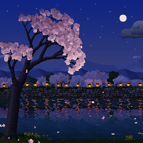
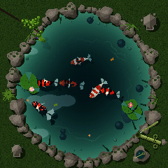
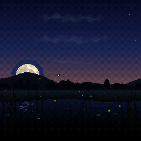

# ZEN-1 (禅) for the M-VAVE FM-1

**ZEN-1** is ambient custom firmware for the M-VAVE FM-1. It turns the little synth into a living window: a
cherry tree drops petals on a river, koi circle a pond, fireflies blink over a summer stream under a real moon,
and every movement you see is a note you hear. Switch it on, set it down, and let it play, soft, slow and never
quite the same. When you want to, reach in: the keys play along with the scene, and the knobs shape every part of it.

<p>



</p>

- **Try it in the browser** (no FM-1 needed): the emulator runs the very code the FM-1 runs, with sound
- **Install it** from Chrome or Edge with the FM-1 on USB, or with `tools/fm1_install.py`
- **The guide**: every control, knob, mood and scene
- **M-Vave SMK-37:** ZEN-1 also builds for the SMK-37; see [SMK37.md](SMK37.md)

The emulator, the installer and the guide are on the project's GitHub Pages site (`tools/publish_pages.sh`).

**Status:** 1.0, the first public release. It runs on the FM-1 and installs and uninstalls the way Felucca, X0X,
FoMni and FuMi-1 do; the installer can put M-VAVE's own firmware back. Installing custom firmware is at your own risk.

## The scenes

| Scene | What happens | Moods |
|---|---|---|
| **Sakura 桜** | A pale Somei-Yoshino cherry over a narrow stream, its stone-walled far bank lined with cherries and paper lanterns under layered spring hills, all mirrored in the water; petal rafts drift by. Each petal that lands plays a koto note, pitched by where it lands; gusts shake loose a shower with a harp run; a bush warbler sings; at night the tree is lit and lanterns glow along the far bank | Morning, Afternoon, Golden Hour, Night |
| **Koi 鯉** | Koi of the real varieties glide, hover and follow each other in a garden pond (a new shape each picture), and every bite of food is a note (deep in the middle low, near the rim high). Japanese pond frogs, a shishi-odoshi, rain rings, a stone lantern at night; uneaten food can come back later as a bowl note | Feeding, Still Pond, Rain, Night |
| **Hotaru 蛍** | Fireflies over a stream, each blinking on its own clock until the field falls into one shared pulse. A moon from NASA's lunar map takes the path its phase really takes; mist, rain, shooting stars, an owl | Dusk, Festival, Quiet Night, Deep Night |

Every scene also has **Natural**, a whole day or night in half an hour with the music following the light. Every
mood remembers your tweaks across power-offs, and can be reset to how it was made.

The music: nothing is a loop. Notes come from what happens on screen, in Japanese pentatonic scales (In, Yo,
Min'yo), over a breathing three-voice drone, with a slow ebb and flow, rests, echoes, reverb and recorded nature
(brook, breeze, crickets, frogs, owl, bush warbler), all on a 6-operator FM engine (Dexed's msfa).

FuMi-1's ST-50-style koto instrument is kept as a mode: hold HOME.

## Controls

ZEN-1 plays by itself. To start, you only need **PRESETS** (the scene), **ALGORITHM** (the mood), **MASTER** (the
volume) and **PLAY** (a new picture). A welcome card shows these the first time it starts.

| Control | What it does in a scene |
|---|---|
| PRESETS | Choose the scene: Sakura, Koi or Hotaru |
| ALGORITHM | Choose the mood: the time of day and the feel |
| SELECT | Activity: how busy the scene is (how many petals, koi food or fireflies, and so how many notes) |
| KNOB 1–4 | The four settings on the page that's showing (see below) |
| FX · SEL | Show the knob pages: FX goes to the next page, SEL to the one before |
| GLO | Switch between the painted look and pixel art |
| PLAY | Draw a new picture: a new tree, pond, or field and moon |
| HOME | Tap: show the battery, scene and mood. Hold: switch to the koto instrument; hold again to come back |
| SEQ | The sleep timer: each press sets the next time (Off, 15 m, 30 m, 1 h, 2 h, 4 h, 8 h). The picture dims over the last ten minutes, then everything fades out; any button or key wakes it |
| SAVE | Tap: save right away (changes also save by themselves about 20 s later). Hold 3 s: reset everything |
| OCT− · OCT+ | Move the notes down or up an octave. **Both held 5 s: update mode**, for installing firmware |
| Keys | White keys play notes that fit the music, and the scene reacts; black keys do something special in each scene |

The knob pages:

- **Scene:** Mood, Activity, Instrument, Space (reverb)
- **Volume:** Notes, Drone (the hum underneath), Air (wind or insects), Water
- **Nature:** two settings of the scene's own, Air Type, Water Type
- **Music:** Echo, Warmth (bright to mellow), Phrases (how notes are chosen), Tide (how much the music slowly swells and fades)

The full list is in the guide (`web/site/guide.html`).

## Building and testing

See [BUILDING.md](BUILDING.md) and [docs/dev-environment.md](docs/dev-environment.md).

```
tests/run_tests.sh                    # host tests, the simulator scenarios, the browser build, the tools
./build.sh                            # build/zen1.fwsc (Docker, JieLi toolchain)
./build.sh --release 1.0.2         # a release package, build/zen-1-1.0.2.fwsc
web/emu/build.sh                      # the browser emulator, and the audition bench for developers (Emscripten)
build/host/zen_host SCRIPT OUTDIR    # the whole app on a computer, from a script (tests/scenarios/*.zen)
tools/site_gallery.sh                 # the site's screenshots, from the simulator
```

The host simulator runs the same app code as the FM-1, writing audio and screenshots, so nearly everything can
be developed and tested without the hardware.

## Layout

| Path | What |
|---|---|
| `firmware/src/app/` | The app: the scenes (`scene_*.c`), the conductor (the music), the 8-bit renderer, the panel and UI, saved settings |
| `firmware/src/dsp/` | Sound: FuMi-1's instrument on the FM6 core, the nature beds and recordings, reverb, tuning |
| `firmware/hal/`, `firmware/loader/`, `firmware/src/*.c` | The platform (Felucca's, via FoMni), kept byte-for-byte; `tools/guard_platform.sh` checks it |
| `host/`, `web/emu/` | The host simulator and the browser emulator |
| `web/site/`, `web/zen_installer.html` | The landing page, the guide and the web installer (`tools/make_pages.py`) |
| `web/bench/` | FuMi-1's audition bench for voicing FM patches (a developer's tool, not on the site) |
| `tools/` | Build, install, rescue, and the generators for patches, samples, fonts and the moon |
| `assets/` | Fonts, the CC0 recordings and the NASA moon map, each with its source |
| `tests/` | Host unit tests and the simulator scenarios |

Comments that cite `docs/research/` refer to FuMi-1's research notes, in
[cartesive/fumi-1](https://github.com/cartesive/fumi-1/tree/main/docs/research).

## Credits

ZEN-1 is built on [FuMi-1](https://github.com/cartesive/fumi-1) by cartesive, whose instrument it keeps as a mode;
on [FoMni](https://github.com/charlesvestal/fm1-fomni) by Charles Vestal; and on the platform of
[Felucca](https://github.com/hugelton/Felucca) by Leo Kuroshita (Hügelton Instruments), by way of
[X0X](https://github.com/charlesvestal/fm1-x0x). The 6-operator FM core is Felucca's C port of msfa (Dexed, Google
and Pascal Gauthier, Apache-2.0). The browser emulator idea comes from Groove OS.

Ideas, not code, came from Charles Vestal's [AMB-1](https://github.com/charlesvestal/fm1-amb) (the breathing drone,
rests, loops and the slow arc), Leo Kuroshita's [Avonlea](https://github.com/kurogedelic/avonlea) (moods), keremimo's
[Melodee](https://github.com/keremimo/melodee) (sending the screen only what changed), ambalek's
[fall](https://github.com/ambalek/fall) (echoes, motifs, a population of falling things) and Dillbo's
[KoiBoi2](https://github.com/Dillbo/KoiBoi2) (food eaten as notes, the pond's memory).

The recordings are CC0, from Freesound ([assets/sounds/README.md](assets/sounds/README.md)); Hotaru's moon is from
NASA's Scientific Visualization Studio CGI Moon Kit, public domain ([assets/images/README.md](assets/images/README.md)).

## License

GPL-3.0-only; see [LICENSING.md](LICENSING.md). M-VAVE and FM-1 are trademarks of their owners; Suiko and ST-50 are
names of Suikohsha. ZEN-1 is independent firmware, not affiliated with or endorsed by any of them. It never enables
the hardware's Bluetooth or Wi-Fi radio.
